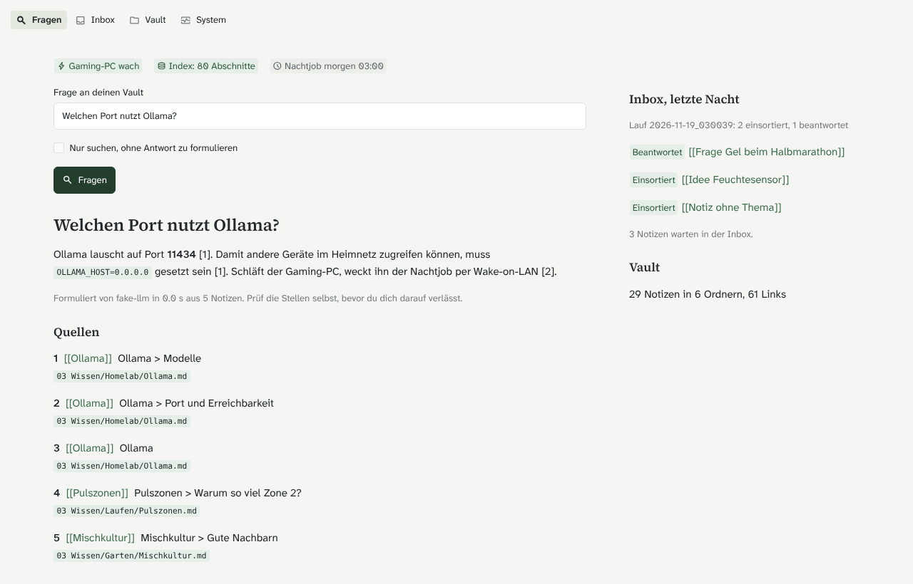
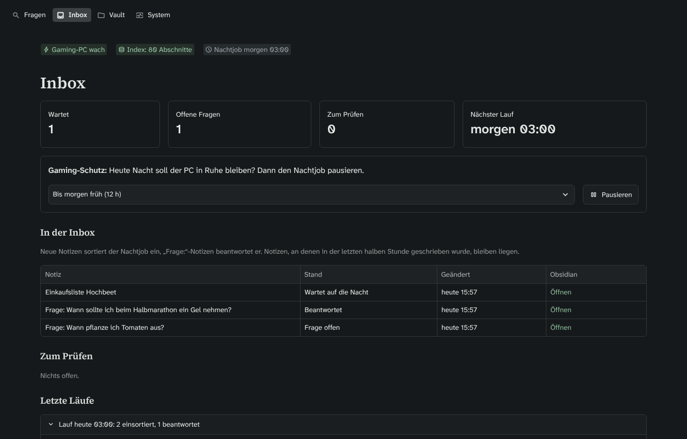

# Obsidian-Assistent

Ein lokaler RAG-Assistent für einen Obsidian-Vault. Er beantwortet Fragen an die eigenen Notizen mit Quellen-Links, sortiert nachts neue Notizen aus der Inbox ein und beantwortet „Frage:“-Notizen. Alles läuft zu Hause: keine Cloud-KI, keine Daten außer Haus.

> **Status:** Phase 5 (Plugin, Hybrid-Suche, Link-Erweiterung). CLI `index`, `ask`, `eval` aus Phase 1, REST-API, Watcher und Docker Compose aus Phase 2, der Nachtjob aus Phase 3 (Inbox sortieren, „Frage:“-Notizen beantworten, Wake-on-LAN, Gaming-Schutz, Protokoll und Rückgängig), das Streamlit-Dashboard aus Phase 4 und jetzt ein Obsidian-Plugin sowie Hybrid-Suche (Vektor + BM25) mit Link-Erweiterung. Eval mit bge-m3 auf 23 Fragen: Treffer@1 100 %, Treffer@5 100 % ([Ergebnisse](docs/eval-ergebnisse.md)).

## Funktionen (Version 1)

- Fragen an den Vault beantworten, immer mit Quellen-Links (`obsidian://`), die die Notiz direkt öffnen
- Neue Notizen in `00 Inbox` nachts verschlagworten, verlinken und einsortieren, mit Protokoll und Rückgängig-Möglichkeit
- „Frage:“-Notizen aus der Inbox über Nacht beantworten
- Dashboard mit Suche, Inbox-Status, Vault-Statistik und Systemstatus

## Architektur

```
Obsidian Sync ──► Mini-PC (Docker Compose)                      Gaming-PC (RTX 2070)
                  ├─ Headless Sync  → Vault (nur lesend)
                  ├─ Indexer        → ChromaDB ◄──── Embeddings ── Ollama (bge-m3)
                  ├─ API (FastAPI)  ── Hybrid-Suche (BM25 + Vektor) ── Ollama (7–8B, Q4)
                  ├─ Nachtjob       ── Wake-on-LAN ─────────────────► weckt den PC
                  └─ Dashboard
Obsidian-Plugin ──► API (Heimnetz / Tailscale)
```

Details: [docs/architecture.md](docs/architecture.md)

## Tech-Stack

Python 3.12 · ohne LangChain/LlamaIndex · Ollama (`bge-m3` + 7–8B-Modell) · ChromaDB · BM25 · FastAPI · Streamlit (später React oder Blazor) · TypeScript-Plugin · Docker Compose · Tailscale

## Schnellstart (Entwicklung)

```bash
python -m venv .venv && source .venv/bin/activate
pip install -e ".[dev]"
cp .env.example .env   # Ollama-URL und Vault-Pfad anpassen

ruff check . && ruff format --check . && pyright && pytest
```

Mit Ollama (Embedding- und Chat-Modell vorher holen: `ollama pull bge-m3`, `ollama pull qwen2.5:7b-instruct-q4_K_M`):

```bash
assistant index demo_vault/                  # nur Geändertes wird neu eingebettet
assistant ask "Welchen Port nutzt Ollama?"   # Antwort mit Quellen als obsidian://-Links
assistant ask --nur-suche "Eisheiligen"      # nur Quellen, ohne Chat-Modell
assistant eval --details                     # Treffer@1 / Treffer@5 als Tabelle
assistant serve                              # REST-API auf http://127.0.0.1:8080, Doku unter /docs
assistant watch                              # Vault beobachten, Änderungen nachindexieren
```

## Betrieb mit Docker Compose

```bash
cp .env.example .env        # VAULT_HOST_PATH auf den Vault, Rest passt für den Start
docker compose up -d --build
curl localhost:8080/status
```

**Vorerst auf dem Gaming-PC:** Solange der Mini-PC fehlt, läuft der Stack mit Docker Desktop auf dem Gaming-PC selbst. Ollama läuft dort direkt (nicht im Container) und ist aus den Containern über `host.docker.internal:11434` erreichbar, das ist der Standard. Weil Docker Desktop unter Windows keine Dateiänderungen in Container meldet, fragt der Watcher den Vault alle 10 s ab (`WATCH_POLLING=true`). Zum Spielen lässt sich alles mit `docker compose stop` anhalten.

**Später auf dem Mini-PC:** Repo und `.env` mitnehmen, in `.env` `OLLAMA_URL_DOCKER=http://<IP-des-Gaming-PCs>:11434` und `WATCH_POLLING=false` setzen, `VAULT_HOST_PATH` auf den Headless-Sync-Ordner. Der Index wird beim ersten Start neu aufgebaut.

| Dienst | Aufgabe |
|---|---|
| `chroma` | ChromaDB, nur im internen Compose-Netz erreichbar, Daten im Volume `chroma` |
| `indexer` | `assistant watch`: beim Start alles indexieren, danach nur geänderte Notizen |
| `api` | `assistant serve` auf Port 8080 |
| `dashboard` | Streamlit auf Port 8501, eigenes schlankes Image, spricht nur mit der API |

Der Vault wird nur lesend eingebunden, die Container laufen ohne Root-Rechte. Ollama läuft nicht im Compose, sondern direkt auf dem Gaming-PC.

### API

| Endpunkt | Zweck |
|---|---|
| `POST /ask` `{"frage": "...", "k": 5}` | Antwort mit nummerierten Quellen (`obsidian://`-Link, Auszug, Score) |
| `POST /search` `{"frage": "...", "k": 5}` | Nur Quellen, ohne Chat-Modell |
| `GET /status` | Anzahl Chunks, Modelle, letzter Indexlauf, ist Ollama erreichbar |
| `POST /reindex` | Vault abgleichen, nur Geändertes wird eingebettet |
| `GET /inbox` | Offene Inbox-Notizen, Ordner „Prüfen“, letzte Nachtläufe, nächster Lauf, Pause |
| `GET /vault` | Vault-Statistik: Notizen, Wörter, Ordner, Tags, tote Links, Notizen ohne Links, zuletzt geändert |
| `GET` / `PUT` / `DELETE /nachtjob/pause` `{"stunden": 12, "grund": "..."}` | Gaming-Schutz lesen, setzen, aufheben |

Schläft der Gaming-PC, antworten `/ask`, `/search` und `/reindex` mit `503` und einem Hinweis; ein leerer Index ergibt `409`. `/inbox` und `/vault` lesen den Vault direkt und gehen auch, wenn der Gaming-PC schläft. Die API schreibt nie in den Vault, nur den Pause-Schalter in den Zustandsordner des Nachtjobs.

## Dashboard



Nach `docker compose up -d --build` unter <http://localhost:8501>. Vier Seiten:

- **Fragen:** Frage stellen oder nur suchen. Die Quellen erscheinen als `[[Wikilink]]`-Chips und öffnen die Notiz direkt in Obsidian. Daneben das Ergebnis der letzten Nacht.
- **Inbox:** was wartet, was zum Prüfen liegt, die letzten Läufe mit allen Aktionen und der Gaming-Schutz: „Heute Nacht in Ruhe lassen“ per Knopf, auch vom Handy.
- **Vault:** Umfang, Ordner, häufigste Tags, zuletzt geändert, tote Links und Notizen ohne Links.
- **System:** API, Ollama, Modelle, Index, „Neu einlesen“.

Das Dashboard spricht nur mit der API (`API_URL`) und braucht nur `streamlit` und `httpx`. So lässt es sich später durch ein React- oder Blazor-Frontend ersetzen, ohne am Backend etwas zu ändern. Das Aussehen („Graphit & Moos“, hell und dunkel) steht nur in [`dashboard/.streamlit/config.toml`](dashboard/.streamlit/config.toml), ohne CSS-Hacks. Die Schriften liegen im Repo (SIL Open Font License), Nutzungsstatistiken an Streamlit sind aus: Das Dashboard lädt nichts aus dem Internet.

Ohne Docker: `pip install -e ".[dashboard]"`, API mit `assistant serve` starten, dann `cd dashboard && streamlit run app.py`.



## Obsidian-Plugin

Die Suche direkt in Obsidian: Seitenleiste „Vault-Assistent“ mit Fragen, „Nur suchen“ und dem Befehl „Ähnliche Notizen zur aktuellen Notiz“. Quellen sind `[[Wikilink]]`-Chips und springen zum passenden Abschnitt. Das Plugin ruft nur die API auf (Heimnetz oder Tailscale), über Obsidians `requestUrl`, und nutzt nur Obsidians CSS-Variablen. Bauen, Testen und Installieren: [`obsidian-plugin/README.md`](obsidian-plugin/README.md).

## Nachtjob

Jede Nacht (Standard 03:00) arbeitet der Nachtjob die Notizen in `00 Inbox` ab:

| Notiz | Was passiert |
|---|---|
| „Frage:“-Notiz (Titel beginnt mit „Frage:“ oder Tag `frage`) | Antwort mit Quellen-Wikilinks wird unter `## Antwort des Assistenten` angehängt, die Notiz bleibt in der Inbox |
| jede andere neue Notiz | Tags ins Frontmatter, verwandte Notizen unter `## Verwandt`, dann in einen **vorhandenen** Ordner verschoben |
| Modell unsicher, Ordner unbekannt, Name schon belegt | nach `00 Inbox/Prüfen`, mit Vorschlag im Protokoll |

**Sicherheitsnetz:** Vor und nach jedem Lauf ein Git-Commit im Vault. Jeder Lauf schreibt ein Protokoll nach `00 Inbox/Protokoll` und speichert die Originaltexte außerhalb des Vaults. `assistant nightly rueckgaengig` stellt alles wieder her, außer Notizen, die seitdem von Hand geändert wurden. Bestehende Notizen fasst die KI nie an, und Notizen, die in den letzten 30 Minuten bearbeitet wurden, bleiben liegen.

**Gaming-Schutz:** Läuft nur im Zeitfenster (Standard 01:00–06:00), lässt sich pausieren und entlädt die Modelle nach jedem Lauf sofort aus dem VRAM. Optional (`NIGHTLY_SKIP_IF_AWAKE=true`) bleibt ein PC in Ruhe, der schon lief, bevor der Nachtjob ihn wecken wollte.

```bash
assistant nightly --probelauf --jetzt    # zeigen, was passieren würde, nichts schreiben
assistant nightly --jetzt                # einmal sofort laufen
assistant nightly pause --stunden 12     # z. B. für eine lange Gaming-Session
assistant nightly weiter
assistant nightly laeufe                 # die letzten Läufe
assistant nightly rueckgaengig [LAUF]    # Standard: der letzte Lauf
```

Im Compose-Betrieb startet der Nachtjob nur auf Wunsch, weil er in den Vault schreibt:

```bash
docker compose --profile nachtjob up -d                                   # vorerst auf dem Gaming-PC
docker compose -f docker-compose.yml -f compose.minipc.yml --profile nachtjob up -d   # Mini-PC
docker compose exec nachtjob assistant nightly --probelauf --jetzt
```

**Ausschalten nach getaner Arbeit:** Hat der Nachtjob den Gaming-PC geweckt, schaltet er ihn per SSH wieder aus, sobald 15 Minuten lang nichts mehr zu tun ist. Ist der PC entsperrt (jemand sitzt davor) oder läuft ein Spiel, bleibt er an. Automatisch greift das erst auf dem Mini-PC, vorher kann der Nachtjob den PC ja nicht wecken. Einrichtung und Regeln: [docs/gaming-pc-ausschalten.md](docs/gaming-pc-ausschalten.md). `assistant nightly ausschalten --pruefen` zeigt die Messwerte, ohne auszuschalten.

Auf dem Mini-PC läuft der Nachtjob im Netz des Hosts, damit das Wake-on-LAN-Paket das Heimnetz erreicht (`GAMING_PC_MAC` in `.env`). Solange alles auf dem Gaming-PC läuft, bleibt `GAMING_PC_MAC` leer.

## Aufbau des Codes

| Modul | Aufgabe |
|---|---|
| `ingest/parser.py` | Frontmatter, Tags, Wikilinks und Überschriften aus Markdown |
| `ingest/chunker.py` | Ein Chunk pro Abschnitt, lange Abschnitte mit Längenlimit und Überlappung |
| `ingest/indexer.py` | Vault oder einzelne Notizen indexieren, nur geänderte Chunks einbetten, gelöschte entfernen |
| `ingest/watcher.py` | `watchdog`-Meldungen sammeln und nach einer Ruhepause gebündelt nachindexieren, bei Fehlern erneut versuchen |
| `index/embedder.py` | Interface `Embedder`, `OllamaEmbedder` (Batching, SQLite-Hash-Cache), `FakeEmbedder` |
| `index/store.py` | Interface `VectorStore`, `ChromaStore` (Metadaten: Pfad, Überschrift, Tags, Hash, Modell), `InMemoryStore` |
| `retrieval/search.py` | Suchmodi vektor, bm25 und hybrid (RRF), beste Notizen, BM25-Rückfall ohne Ollama |
| `retrieval/bm25.py` | Eigene BM25-Suche mit deutschen Stoppwörtern und einfachem Wortstamm |
| `retrieval/links.py` | Link-Erweiterung: per Wikilink verlinkte Notizen hinter die besten Treffer setzen |
| `llm/` | Interface `LLM`, `OllamaLLM`, `FakeLLM`, Prompts, Antwort mit nummerierten Quellen |
| `evaluation.py` | Eval-Set laden, Treffer@k je Fragetyp |
| `api/app.py` | FastAPI: `/ask`, `/search`, `/status`, `/reindex`, `/inbox`, `/vault`, `/nachtjob/pause` |
| `statistik.py` | Vault-Statistik direkt aus den Dateien (Ordner, Tags, tote Links, ohne Links) |
| `nightly/uebersicht.py` | Inbox und letzte Nachtläufe fürs Dashboard, nur lesend |
| `components.py` | Baut Embedder, VectorStore und LLM aus der Konfiguration (Chroma lokal oder per HTTP) |
| `nightly/wol.py` | Magic Packet senden, auf Ollama warten, Paket bei Bedarf wiederholen |
| `nightly/guard.py` | Gaming-Schutz: Zeitfenster, Pause-Schalter, Startzeit |
| `nightly/inbox.py` | Inbox-Notizen finden, Ordner und Tags per JSON vom Modell, Tags und Links einfügen |
| `nightly/questions.py` | „Frage:“-Notizen beantworten |
| `nightly/protocol.py` | Protokoll (Markdown + JSON) und Rückgängig |
| `nightly/power.py` | Gaming-PC per SSH ausschalten, wenn er selbst geweckt wurde und lange genug ruhig ist |
| `nightly/vault_git.py` | Git-Commit vor und nach dem Lauf |
| `nightly/job.py` | Ein Nachtlauf von Wecken bis Entladen |
| `cli.py` | Befehle `index`, `ask`, `eval`, `serve`, `watch` und `nightly` |
| `dashboard/` | Streamlit-App: `api_client.py` (typisierter Client), `ansicht.py` (Texte, Zeiten, Chips), `seiten/` |

Alle Tests laufen ohne Ollama: mit `FakeEmbedder` (Bag-of-Words über Hashing), `FakeLLM`, `FakeWaker` und einem simulierten Ollama-Server (`httpx.MockTransport`). Der Nachtjob wird auf einer Kopie des Demo-Vaults mit echtem Git getestet, inklusive Rückgängig. Die API wird mit dem `TestClient` von FastAPI getestet, das Dashboard mit `AppTest` von Streamlit gegen eine echte API mit Fakes, der Watcher mit einem echten `watchdog`-Observer auf einer Kopie des Demo-Vaults.

## Demo-Vault und Evaluation

`demo_vault/` enthält 25 fiktive Notizen zu drei klar getrennten Themen (Homelab/Docker, Garten, Laufen). Echte Notizen kommen nie ins Repo.

`eval/questions.yaml` enthält 23 Fragen mit der Notiz, die gefunden werden soll: exakte Begriffe, Umschreibungen, Fragen, die mehrere Notizen brauchen, und Fragen, deren zweite Notiz über einen Wikilink erreichbar ist. Ziel für Version 1: Treffer@5 ≥ 80 %, Treffer@1 ≥ 50 %, Antwortzeit < 15 s.

Stand 21.11.2026 mit `bge-m3`, Hybrid-Suche (Vektor + BM25) und Link-Erweiterung: **Treffer@1 100 %, Treffer@5 100 %** auf allen 23 Fragen (reine Vektorsuche: 96 % und 100 %). BM25 allein, also ohne Ollama, erreicht mit Link-Erweiterung 65 % und 91 %. Details in [docs/eval-ergebnisse.md](docs/eval-ergebnisse.md).

## Roadmap

| Phase | Inhalt |
|---|---|
| 0 | Vorbereitung: Repo, Demo-Vault, Eval-Set, Hardware |
| 1 | CLI-MVP: `index`, `ask`, `eval` |
| 2 | FastAPI, Docker Compose, Mini-PC, Headless Sync, inkrementelles Indexieren |
| 3 | Nachtjob: Inbox-Sortierer, Fragen-Beantworter, Wake-on-LAN |
| 4 | Dashboard: Streamlit, dann React oder Blazor |
| 5 | Obsidian-Plugin, Hybrid-Suche + Link-Erweiterung, Demo-Video, Eval-Ergebnisse |
