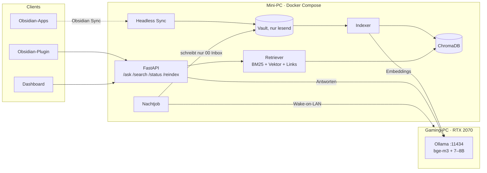
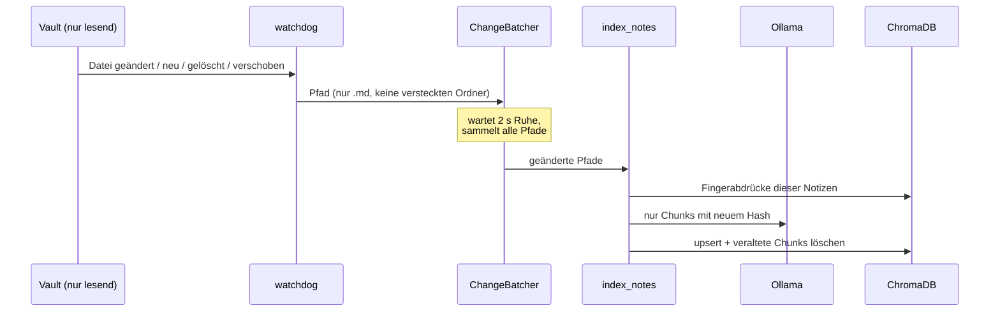

# Architektur

Drei Ebenen: Vault und Sync, Dienste auf dem Mini-PC, KI auf dem Gaming-PC.

## Datenfluss einer Frage

1. Plugin oder Dashboard schickt die Frage an `/ask`.
2. Der Retriever kombiniert BM25 und Vektorsuche und ergänzt verlinkte Notizen.
3. Die besten Chunks gehen mit einem Prompt an das Chat-Modell in Ollama.
4. Die Antwort kommt mit Quellen als `obsidian://`-Links zurück.

## Schnittstellen im Code

`Embedder`, `VectorStore` und `LLM` sind Interfaces. Für Tests gibt es `FakeEmbedder` und `FakeLLM`, damit die Tests ohne Ollama laufen. Diese Teile entstehen in Phase 1.

## Phase 2: Dienste und inkrementelles Indexieren

Ein Docker-Image, zwei Befehle: `assistant watch` (Indexer) und `assistant serve` (API). Beide sprechen ChromaDB per HTTP an (`CHROMA_HOST=chroma`) und teilen sich den Embedding-Cache im Volume `cache`.

**Hash-Vergleich:** Jeder Chunk hat einen Fingerabdruck aus SHA-256 seines Textes und dem Embedding-Modell. Beim Nachindexieren werden nur die Chunks der gemeldeten Notizen mit dem Index verglichen. Gleicher Fingerabdruck heißt: kein Aufruf an Ollama. Wechselt das Modell, ändern sich alle Fingerabdrücke und alles wird neu eingebettet.

**Warum sammeln?** Obsidian speichert beim Tippen alle paar Sekunden, Sync schreibt viele Dateien kurz hintereinander. Der `ChangeBatcher` wartet, bis zwei Sekunden lang nichts passiert, und indexiert dann einmal. Schläft der Gaming-PC, bleiben die Pfade vorgemerkt und werden nach 60 Sekunden erneut versucht.

**Fehlerbilder der API:** Ollama nicht erreichbar → `503` mit Hinweis auf den Gaming-PC. Leerer Index → `409`. Zwei `/reindex` gleichzeitig → der zweite bekommt `409`.
