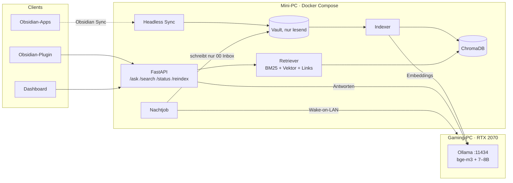

# Architektur

Drei Ebenen: Vault und Sync, Dienste auf dem Mini-PC, KI auf dem Gaming-PC.

## Datenfluss einer Frage

1. Plugin oder Dashboard schickt die Frage an `/ask`.
2. Der Retriever kombiniert BM25 und Vektorsuche und ergänzt verlinkte Notizen.
3. Die besten Chunks gehen mit einem Prompt an das Chat-Modell in Ollama.
4. Die Antwort kommt mit Quellen als `obsidian://`-Links zurück.

## Schnittstellen im Code

`Embedder`, `VectorStore` und `LLM` sind Interfaces. Für Tests gibt es `FakeEmbedder` und `FakeLLM`, damit die Tests ohne Ollama laufen. Diese Teile entstehen in Phase 1.
