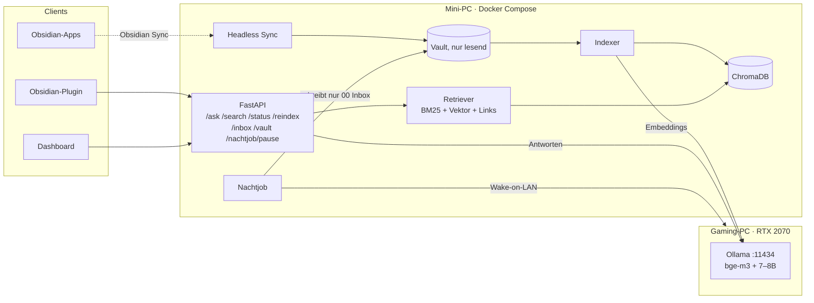
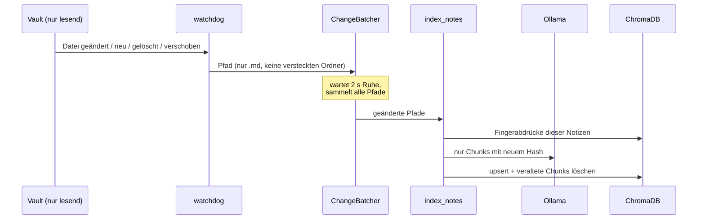
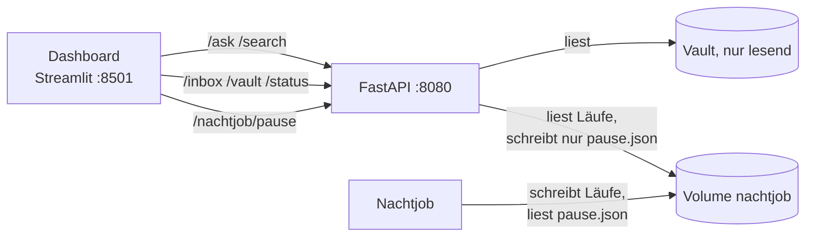

# Architektur

Drei Ebenen: Vault und Sync, Dienste auf dem Mini-PC, KI auf dem Gaming-PC.



## Datenfluss einer Frage

1. Plugin oder Dashboard schickt die Frage an `/ask`.
2. Der Retriever kombiniert BM25 und Vektorsuche und ergänzt verlinkte Notizen.
3. Die besten Chunks gehen mit einem Prompt an das Chat-Modell in Ollama.
4. Die Antwort kommt mit Quellen als `obsidian://`-Links zurück.

## Schnittstellen im Code

`Embedder`, `VectorStore` und `LLM` sind Interfaces. Für Tests gibt es `FakeEmbedder` und `FakeLLM`, damit die Tests ohne Ollama laufen. Diese Teile entstehen in Phase 1.

## Phase 2: Dienste und inkrementelles Indexieren

Bis der Mini-PC da ist, laufen die Container mit Docker Desktop auf dem Gaming-PC und erreichen Ollama über `host.docker.internal`. Für den Umzug ändern sich nur zwei Werte in `.env` (`OLLAMA_URL_DOCKER`, `WATCH_POLLING`).

Ein Docker-Image, zwei Befehle: `assistant watch` (Indexer) und `assistant serve` (API). Beide sprechen ChromaDB per HTTP an (`CHROMA_HOST=chroma`) und teilen sich den Embedding-Cache im Volume `cache`.



**Hash-Vergleich:** Jeder Chunk hat einen Fingerabdruck aus SHA-256 seines Textes und dem Embedding-Modell. Beim Nachindexieren werden nur die Chunks der gemeldeten Notizen mit dem Index verglichen. Gleicher Fingerabdruck heißt: kein Aufruf an Ollama. Wechselt das Modell, ändern sich alle Fingerabdrücke und alles wird neu eingebettet.

**Warum sammeln?** Obsidian speichert beim Tippen alle paar Sekunden, Sync schreibt viele Dateien kurz hintereinander. Der `ChangeBatcher` wartet, bis zwei Sekunden lang nichts passiert, und indexiert dann einmal. Schläft der Gaming-PC, bleiben die Pfade vorgemerkt und werden nach 60 Sekunden erneut versucht.

**Fehlerbilder der API:** Ollama nicht erreichbar → `503` mit Hinweis auf den Gaming-PC. Leerer Index → `409`. Zwei `/reindex` gleichzeitig → der zweite bekommt `409`.

## Phase 3: Nachtjob

Der Nachtjob ist ein eigener Container (`assistant nightly dienst`, Compose-Profil `nachtjob`). Er schläft bis `NIGHTLY_TIME` und arbeitet dann die Inbox ab.

```mermaid
sequenceDiagram
    participant N as Nachtjob
    participant G as Gaming-PC / Ollama
    participant V as Vault (Git)
    participant C as ChromaDB
    N->>N: Gaming-Schutz: Zeitfenster? Pause?
    N->>G: /api/tags erreichbar?
    alt schläft
        N->>G: Magic Packet (alle 60 s, max. WOL_WAIT_S)
    end
    N->>V: git commit „Stand vor Lauf“
    N->>C: Index abgleichen
    loop jede Notiz direkt in 00 Inbox
        alt „Frage:“-Notiz
            N->>C: Suche (ohne Inbox)
            N->>G: Antwort mit Quellen
            N->>V: Antwort an die Frage-Notiz anhängen
        else neue Notiz
            N->>C: verwandte Notizen
            N->>G: JSON: Ordner, Tags, sicher?
            N->>V: Tags + Links, verschieben (oder 00 Inbox/Prüfen)
        end
    end
    N->>V: Protokoll-Notiz, git commit „Lauf …“
    N->>G: Modelle entladen (keep_alive 0)
    opt PC wurde vom Nachtjob geweckt
        loop jede Minute, bis 15 min Ruhe
            N->>G: SSH: gesperrt? (LogonUI), nvidia-smi; HTTP: /api/ps
        end
        N->>G: SSH: shutdown /s /t 60
    end
```

**Warum JSON und eine feste Ordnerliste?** Ein 7–8B-Modell erfindet sonst gern Ordner. Das Modell bekommt die vorhandenen Ordner mit einigen Notiztiteln als Beispiel und muss einen davon wählen; Ollama erzwingt mit `format: "json"` gültiges JSON. Alles, was nicht passt (unbekannter Ordner, „sicher“ nicht `true`, kaputtes JSON), landet in `00 Inbox/Prüfen`.

**Rückgängig ohne Git-Kenntnisse:** Der Lauf speichert pro Notiz Quelle, Ziel, Originaltext und den Hash des geschriebenen Textes (`NIGHTLY_STATE_PATH/laeufe/<id>.json`). Rückgängig schreibt den Originaltext zurück, aber nur, wenn die Notiz noch genau so aussieht, wie der Nachtjob sie hinterlassen hat. Git bleibt zusätzlich als Sicherheitsnetz.

**Gaming-Schutz:** Vom Server aus ist nicht sichtbar, ob ein Spiel läuft. Deshalb einfache, nachvollziehbare Regeln: nur im Zeitfenster, Pause-Schalter, Modelle sofort entladen, optional einen schon wachen PC in Ruhe lassen.

**Netz:** Ein UDP-Broadcast verlässt das Docker-Bridge-Netz nicht. Auf dem Mini-PC läuft der Nachtjob deshalb mit `network_mode: host` (`compose.minipc.yml`) und erreicht ChromaDB über `127.0.0.1:8000`.

**Ausschalten:** Wake-on-LAN kann nur einschalten. Zum Ausschalten nutzt der Nachtjob den eingebauten OpenSSH-Server von Windows. Ruhe heißt: kein Modell in Ollama geladen (sonst läuft gerade Arbeit), PC gesperrt (niemand davor), GPU ruhig. Details: [gaming-pc-ausschalten.md](gaming-pc-ausschalten.md).

## Phase 4: Dashboard

Das Dashboard ist ein eigener Container und kennt nur die API. Alles, was es zeigt, kommt über REST:



- **Warum nur über die API?** So bleibt das Frontend austauschbar (React oder Blazor später) und braucht weder Chroma noch Ollama noch Schreibrechte am Vault.
- **Inbox und Statistik lesen den Vault direkt**, nicht den Index. Sie stimmen deshalb auch, wenn der Gaming-PC schläft und noch nicht alles eingebettet ist.
- **Pause per Knopf:** Der Gaming-Schutz aus Phase 3 (`assistant nightly pause`) ist jetzt auch im Dashboard. Die API schreibt dafür `pause.json` ins gemeinsame Volume, der Nachtjob liest sie vor jedem Lauf.
- **Design nur über das Theme:** Farben, Schriften, Radien und Diagrammfarben stehen in `dashboard/.streamlit/config.toml`, hell und dunkel getrennt. Keine eigenen CSS-Regeln, damit Streamlit-Updates nichts zerbrechen.

## Phase 5: Obsidian-Plugin

Das Plugin ist ein zweites Frontend neben dem Dashboard und nutzt dieselben Endpunkte (`/ask`, `/search`, `/status`).

- **`requestUrl` statt `fetch`:** Obsidian schickt die Anfrage selbst, ohne CORS. Die API braucht dafür keine Änderung, und es geht auch in der mobilen App.
- **Testbar ohne Obsidian:** Der API-Client bekommt die HTTP-Funktion hineingereicht, Textfunktionen und Einstellungen liegen in eigenen Dateien ohne Obsidian-Import. `vitest` testet sie ohne Obsidian und ohne API.
- **Ähnliche Notizen** brauchen keinen neuen Endpunkt: Titel und Anfang der aktiven Notiz (ohne Frontmatter, Code und Markdown-Zeichen) gehen als Suchtext an `/search`. `/search` liefert schon je Notiz den besten Abschnitt. Das Plugin holt einen Treffer mehr und lässt die Notiz selbst weg.
- **Quellen öffnen per `openLinkText`** mit `Pfad#Überschrift`, also wie ein normaler Wikilink: Strg/Cmd-Klick öffnet einen neuen Tab.
