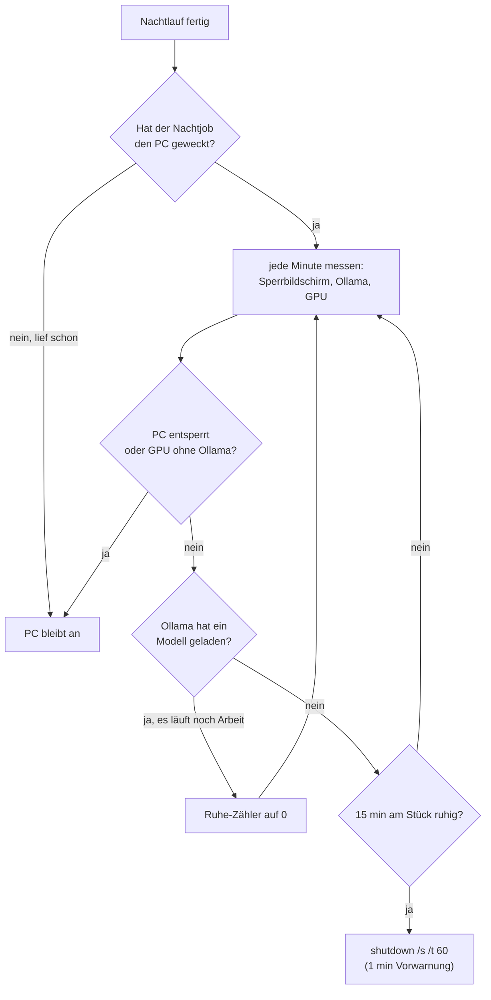

# Gaming-PC nach getaner Arbeit ausschalten

Wake-on-LAN kann den Gaming-PC nur einschalten. Zum Ausschalten meldet sich der Nachtjob per SSH an und ruft `shutdown` auf. Er tut das nur, wenn er den PC selbst geweckt hat und danach alles ruhig ist.

> **Wann es greift:** Automatisch erst nach dem Umzug auf den Mini-PC. Solange der Stack auf dem Gaming-PC läuft, kann der Nachtjob den PC nicht wecken (er läuft ja nur, wenn der PC an ist), also schaltet er ihn auch nie von selbst aus. Von Hand geht es schon jetzt: `assistant nightly ausschalten`.

## Wann ausgeschaltet wird



- **Weitere Arbeit:** Solange Ollama ein Modell geladen hat, läuft gerade oder lief eben eine Anfrage (Nachtjob, Dashboard, Plugin). Dann beginnt die Ruhezeit von vorn. Ausgeschaltet wird erst, wenn `SHUTDOWN_RUHE_MIN` Minuten (Standard 15) am Stück nichts passiert ist.
- **Jemand sitzt davor:** Nach dem Autologon sperrt eine geplante Aufgabe den PC sofort. Ist er entsperrt, sitzt jemand davor, und der Nachtjob bricht ab. Erkannt wird das am Prozess `LogonUI.exe`, den Windows nur für Sperr- und Anmeldebildschirm startet. Ebenso bricht er ab, wenn die GPU arbeitet, ohne dass Ollama ein Modell geladen hat (vermutlich ein Spiel), oder wenn sich etwas nicht messen lässt. Im Zweifel bleibt der PC an.
- **Höchstens warten:** Nach `SHUTDOWN_MAX_WARTEN_MIN` (Standard 120) gibt der Nachtjob auf und lässt den PC an.
- **Abbrechen:** Innerhalb der Minute Vorwarnung am PC `shutdown /a` eingeben.

Das funktioniert gleich, wenn der Stack später auf den Mini-PC umzieht. Nur das SSH-Ziel ändert sich.

## Einrichtung am Gaming-PC (Windows 11, einmalig)

1. **OpenSSH-Server installieren:** *Einstellungen → System → Optionale Features → Feature hinzufügen → OpenSSH-Server*. Dann in PowerShell als Administrator:

   ```powershell
   Start-Service sshd
   Set-Service -Name sshd -StartupType Automatic
   ```

2. **Firewall nur fürs Heimnetz:** Die Regel „OpenSSH SSH Server (sshd)“ unter *Windows Defender Firewall → Erweiterte Einstellungen → Eingehende Regeln* auf das Profil *Privat* und den Bereich des Heimnetzes beschränken (wie bei Ollama).

3. **Schlüssel erzeugen** (im Repo-Ordner, der Ordner `secrets/` wird nie committet). Bei der Frage nach einer Passphrase zweimal Enter drücken, der Nachtjob kann keine eingeben:

   ```powershell
   mkdir secrets
   ssh-keygen -t ed25519 -C nachtjob -f secrets/gaming_pc_ed25519
   ```

4. **Öffentlichen Schlüssel eintragen:** Ist dein Windows-Konto Administrator (meistens), gehört er nach `C:\ProgramData\ssh\administrators_authorized_keys`, sonst nach `%USERPROFILE%\.ssh\authorized_keys`. In PowerShell als Administrator (die Kennungen stehen für Administratoren und SYSTEM, das klappt in jeder Windows-Sprache):

   ```powershell
   Get-Content secrets\gaming_pc_ed25519.pub | Add-Content C:\ProgramData\ssh\administrators_authorized_keys
   icacls C:\ProgramData\ssh\administrators_authorized_keys /inheritance:r /grant "*S-1-5-32-544:F" /grant "*S-1-5-18:F"
   ```

5. **In `.env` eintragen:** `GAMING_PC_SSH=<benutzer>@host.docker.internal` (später `<benutzer>@<IP-des-Gaming-PCs>`). Bei einem Microsoft-Konto ist `<benutzer>` der Name des Benutzerordners.

6. **Testen**, ohne auszuschalten:

   ```bash
   docker compose --profile nachtjob up -d
   docker compose exec nachtjob assistant nightly ausschalten --pruefen
   ```

   Das zeigt, ob Ollama beschäftigt ist, ob der PC gesperrt ist, die GPU-Last und die Bewertung.

`assistant nightly ausschalten` (ohne `--pruefen`) wartet auf Ruhe und schaltet dann wirklich aus. Das ist gut für einen echten Test vor dem Schlafengehen.
